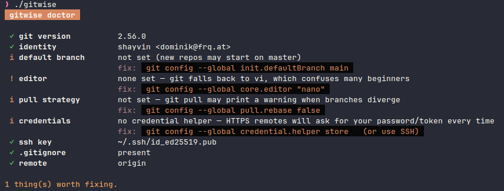

# Gitwise


A friendly mentor in your terminal that helps new developers get comfortable with the git CLI.
Built with [Bubble Tea](https://github.com/charmbracelet/bubbletea), [Lip Gloss](https://github.com/charmbracelet/lipgloss),
[Huh](https://github.com/charmbracelet/huh) and [Cobra](https://github.com/spf13/cobra).

```sh
go install .      # or: go build -o gitwise .
gitwise           # interactive menu
```

| Command | What it does |
|---|---|
| `gitwise status` | Explains the repo state in plain words (staged / unstaged / untracked / conflicts, ahead/behind, merge or rebase in progress) and suggests the next commands. |
| `gitwise learn [id]` | Hands-on lessons in a throwaway sandbox: first commit, branching, undoing, merge conflicts, stash, remotes. Progress is saved. |
| `gitwise explain <cmd>` | Breaks down any git command word by word: flags, combined short flags, refs like `HEAD~2`, `main..feature`, `stash@{1}`, your aliases, plus typo suggestions. |
| `gitwise run <git args>` | Runs git with a safety net: warns about force pushes, `reset --hard`, `clean -f`, etc., offers a backup branch, and shows next steps afterwards. Try `alias g="gitwise run"`. |
| `gitwise undo` | "Oh no" recipes (unstage, amend, undo commit, recover from reflog, abort merge…), with the ones matching your current repo state marked ★. Fills in files/commits interactively and can run the fix. |
| `gitwise commit` | Guided commit: choose files, Conventional Commit type/scope, summary with checks, preview, commit. |
| `gitwise cheatsheet` | Searchable cheatsheet (`-p` to print it). |
| `gitwise glossary [term]` | HEAD, upstream, staging area, detached HEAD… explained. |
| `gitwise doctor` | Checks your git setup (identity, editor, default branch, credentials, SSH key, .gitignore) and offers to set your name/email. |

## Development

```sh
go test ./...   # includes a test that plays through every lesson using its hints
```

Layout: `internal/git` (git wrapper and status parser), `internal/knowledge` (command docs, danger rules,
glossary, undo recipes), `internal/advisor` (next-step suggestions), `internal/lessons` (sandbox and lessons),
`internal/ui` (styles and Bubble Tea components), `internal/cmd` (Cobra commands).
